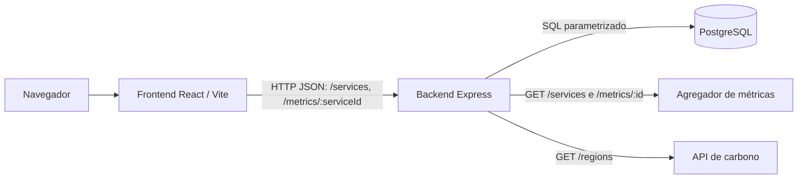

# Arquitetura do EcoByteMetrics

Este documento descreve a implementação da sequência de branches #33–#36, baseada na `develop` e revisada em 30/10/2026.

## Visão geral

O sistema contém uma interface React + TypeScript, uma API Node.js + TypeScript com Express, um PostgreSQL acessado por SQL nativo e duas integrações externas: o agregador de métricas e o serviço de intensidade de carbono.

## Componentes

- **Frontend:** `frontend/src/features/monitoring` faz consultas ao backend e à API de carbono, interpreta os resultados e apresenta estados como disponível, dados desatualizados, indisponível e sem métricas.
- **Backend:** `backend/src/app.ts` registra as rotas públicas e os módulos REST. `backend/src/server.ts` inicia o servidor e as atualizações periódicas.
- **Integrações:** `backend/src/integrations/metrics-api.ts` consulta serviços e métricas; `carbon-api.ts` consulta os fatores regionais.
- **Persistência:** `backend/src/db/connection.ts` configura o pool de PostgreSQL. Os repositórios em `backend/src/modules` executam SQL parametrizado; o esquema está em `database/DDL.sql`.
- **Docker Compose:** `compose.yaml` define os serviços `frontend`, `backend` e `postgres`. As variáveis de exemplo estão em `.env.example`.

## Polling e coleta

O servidor executa `refreshAllData()` uma vez ao iniciar e, depois, a cada 30 segundos. Essa rotina chama `runWorker()`, que descobre serviços, consulta a API de métricas, grava cada amostra na tabela `Metrics` e atualiza o cache somente após a gravação bem-sucedida. O lock em `worker.job.ts` impede ciclos sobrepostos; o Express não inicia um segundo polling ao importar `app.ts`.

Falhas em uma consulta de métricas são registradas por serviço e não impedem a coleta dos demais. O estado é exposto em `GET /metrics/:serviceId`: falhas de comunicação retornam `503 service_unavailable`, e respostas inválidas ou sem métricas retornam `404 metrics_missing`. A interface exibe esses estados por serviço. Falhas globais na API de métricas mantêm a última descoberta, marcam os serviços conhecidos como indisponíveis e não encerram o backend. A falha na API de carbono é isolada da coleta das métricas.

## Rotas principais do monitoramento

| Método e caminho | Função |
|---|---|
| `GET /health` | Verifica a disponibilidade do backend |
| `GET /services` | Retorna os serviços descobertos e o horário da última descoberta |
| `GET /metrics` | Retorna as métricas disponíveis em memória |
| `GET /metrics/:serviceId` | Retorna a amostra mais recente do serviço solicitado |

As rotas CRUD de usuários, métricas, serviços, carbonos e localizações ficam sob `/api/users`, `/api/metrics`, `/api/services`, `/api/carbons` e `/api/locations`. As rotas de resumo e ranking ficam sob `/api/statistics`; autenticação fica sob `/auth`.

## Persistência

O banco é PostgreSQL nativo, sem ORM. O DDL define usuários, localizações, serviços, métricas e carbonos. Os repositórios usam consultas SQL parametrizadas para leitura e gravação.

## Referências

- [README principal](../README.md)
- [Contratos das rotas](./api.md)
- [Plano de entregas](./plano-de-entregas.md)
- [Script DDL](../database/DDL.sql)
- [Docker Compose](../compose.yaml)
- [Exemplo de ambiente](../.env.example)
